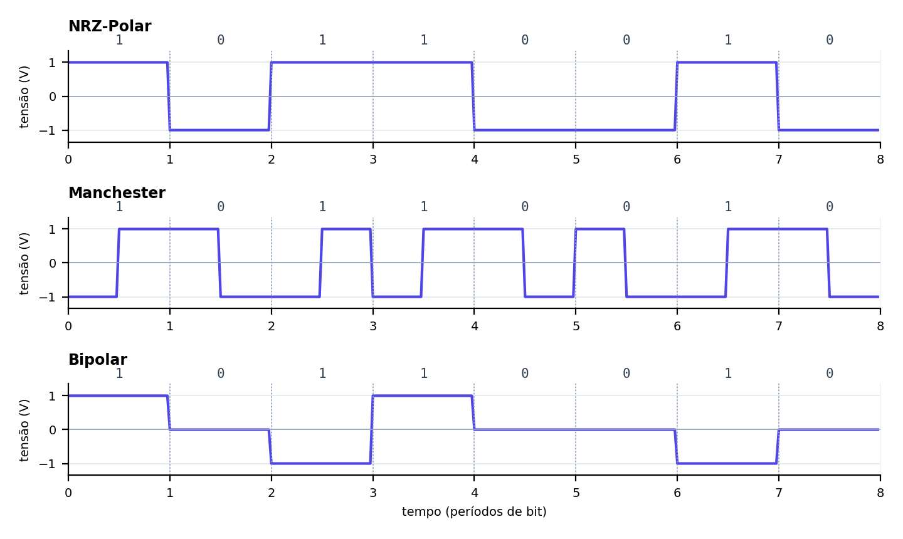
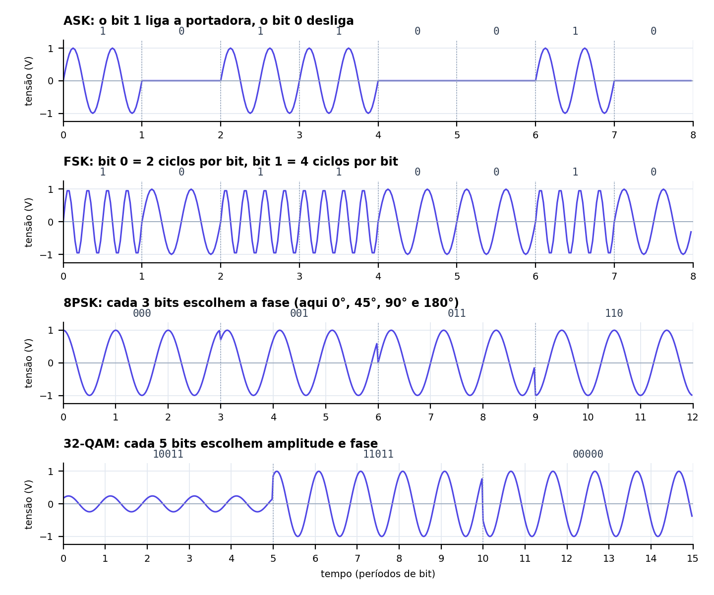
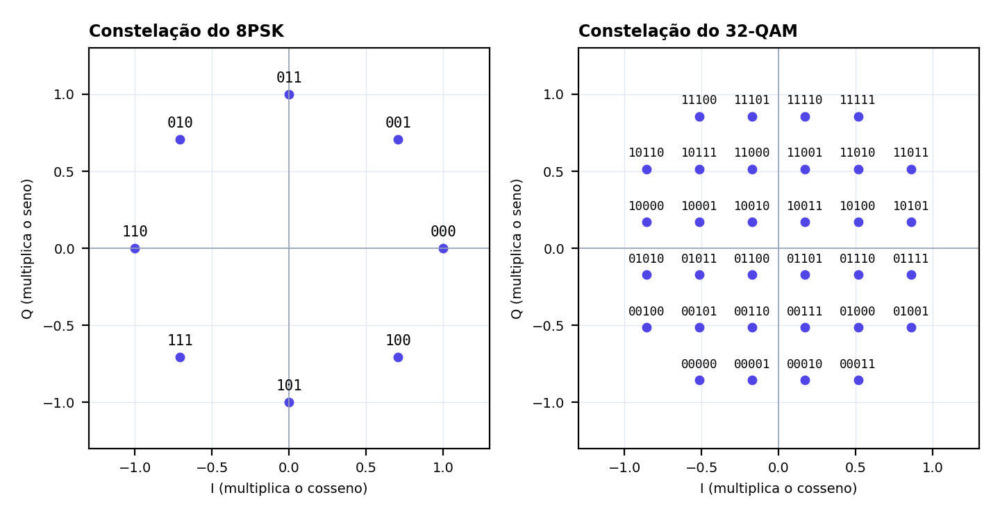
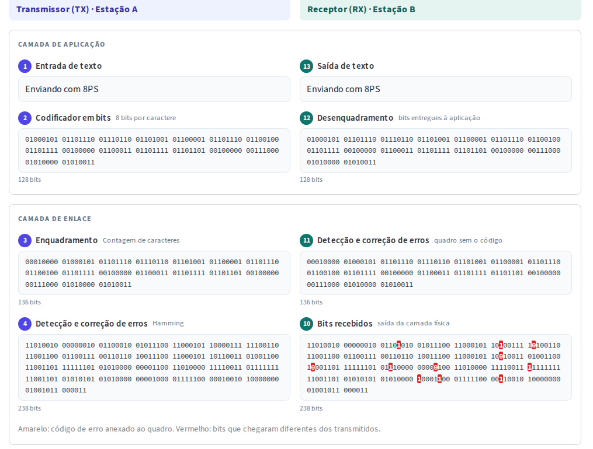
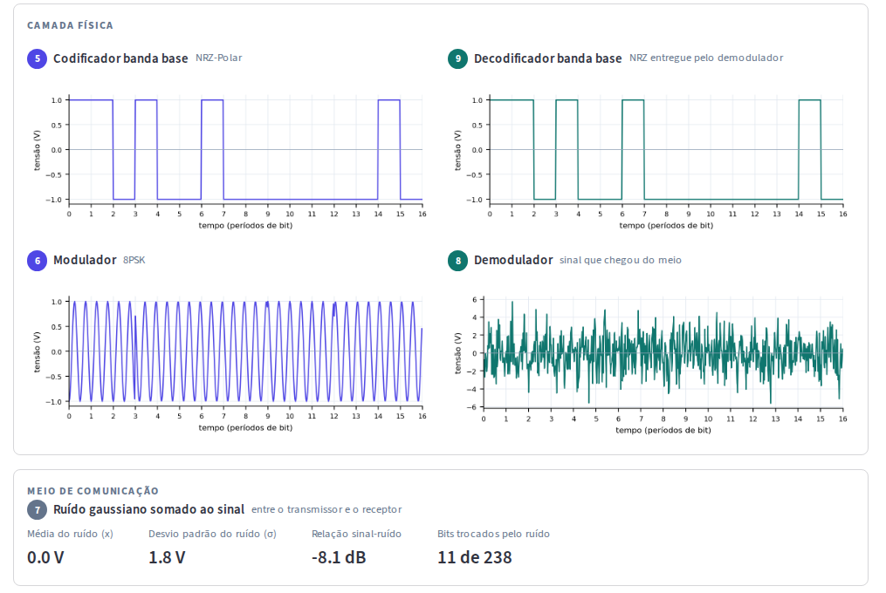
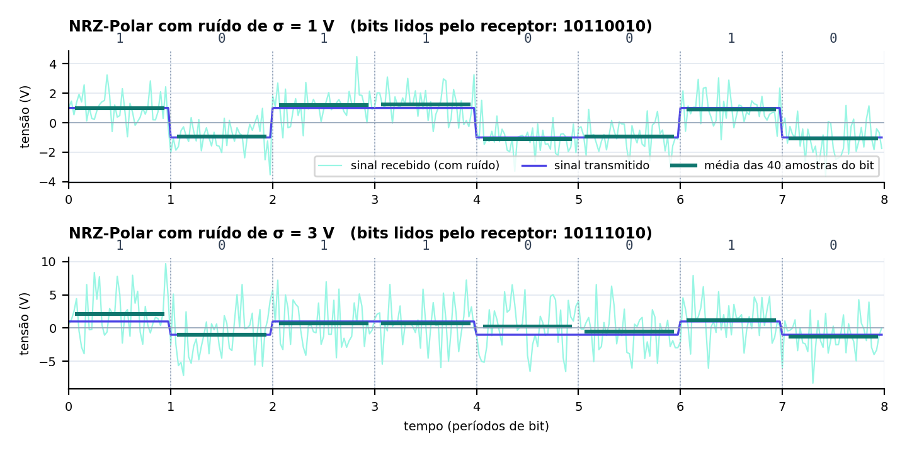

# Simulador TR1: guia de estudo

**Camadas física e de enlace, do conceito ao código.** Este guia explica o que o simulador faz, a ideia de TR1 por trás de cada técnica e o que cada trecho de Python está fazendo. Foi escrito para quem vai apresentar o trabalho e precisa responder perguntas sobre qualquer parte dele.

Como ler: as seções 1 a 3 dão a visão geral. A seção 4 explica as construções de Python que aparecem no código (inclusive o `for _ in range(...)`). As seções 5 a 8 percorrem os quatro arquivos. As seções 9 a 11 preparam para a demonstração e para as perguntas.

[TOC]

## 1. O que o simulador faz

O simulador é um chat de texto entre duas estações, A e B, na mesma tela. Quem escreve é o **transmissor** e a outra estação é o **receptor**. A mensagem não é copiada de um lado para o outro. Ela é transformada em bits, embrulhada em quadros, protegida com um código de erro, convertida em sinal elétrico (tensões em volts) e misturada com ruído. Do outro lado, tudo é desfeito na ordem inversa. O texto que aparece no receptor é o que sobrou depois desse caminho.

Para executar, dentro da pasta do projeto:

```bash
uv run streamlit run Simulador.py
```

A tela tem três partes:

- **Barra lateral (Configuração geral):** escolhe o enquadramento, o método de detecção ou correção, as modulações e o ruído.
- **Chat:** uma caixa por estação. Mensagens enviadas ficam em azul; recebidas ficam em verde-claro, com o resultado da verificação de erros embaixo.
- **Por dentro da transmissão:** mostra, para a mensagem escolhida, a saída de cada etapa no transmissor e no receptor.

<figure>

<figcaption>Figura 1. Barra lateral e chat. A terceira mensagem chegou com erros que o Hamming corrigiu.</figcaption>
</figure>

## 2. O caminho de uma mensagem

Toda mensagem passa por 13 etapas. As etapas 1 a 6 acontecem no transmissor (TX), a 7 é o meio de comunicação e as etapas 8 a 13 acontecem no receptor (RX).

| Nº | Lado | Etapa | O que sai dela | Função no código |
|---|---|---|---|---|
| 1 | TX | Entrada de texto | o texto digitado | `InterfaceGUI.desenhar_chat` |
| 2 | TX | Codificador em bits | bits do texto | `Simulador.texto_para_bits` |
| 3 | TX | Enquadramento | o quadro | `CamadaEnlace.enquadrar` |
| 4 | TX | Detecção e correção | quadro + código de erro | `CamadaEnlace.adicionar_edc` |
| 5 | TX | Codificador banda base | sinal em volts | `CamadaFisica.codificar_banda_base` |
| 6 | TX | Modulador | sinal modulado | `CamadaFisica.modular` |
| 7 | Meio | Ruído | sinal + ruído | `Simulador.meio_de_comunicacao` |
| 8 | RX | Demodulador | sinal NRZ | `CamadaFisica.demodular` |
| 9 | RX | Decodificador banda base | bits recebidos | `CamadaFisica.decodificar_banda_base` |
| 10 | RX | Bits recebidos | (o que a camada física entregou) | |
| 11 | RX | Detecção e correção | quadro sem o código | `CamadaEnlace.verificar_edc` |
| 12 | RX | Desenquadramento | bits da aplicação | `CamadaEnlace.desenquadrar` |
| 13 | RX | Saída de texto | o texto recebido | `Simulador.bits_para_texto` |

Na tela, o receptor aparece numerado de trás para frente (13, 12, 11...). Isso é de propósito: o receptor desfaz os passos na ordem inversa, então cada linha da tela mostra **a mesma coisa nas duas pontas**. A linha de 1 e 13 é o texto, a de 2 e 12 são os bits do texto, a de 3 e 11 é o quadro, a de 4 e 10 é o quadro com o código de erro, a de 5 e 9 é o sinal banda base e a de 6 e 8 é o sinal modulado. Leia a coluna do transmissor de cima para baixo e a do receptor de baixo para cima.

Quando a transmissão é em banda base (sem portadora), as etapas 6 e 8 não são usadas: o sinal da etapa 5 vai direto para o meio.

### Exemplo completo: a mensagem "Oi"

Configuração: contagem de caracteres, bit de paridade par, NRZ-Polar, amplitude de 1 V. Todos os valores abaixo foram calculados pelo próprio código.

1. **Texto:** `Oi`.
2. **Bits:** a letra `O` tem código 79, que em 8 bits é `01001111`. A letra `i` tem código 105, que é `01101001`. Juntando: `0100111101101001` (16 bits).
3. **Quadro:** a contagem de caracteres coloca na frente um cabeçalho de 8 bits com a quantidade de bytes, que é 2: `00000010`. O quadro fica `00000010 01001111 01101001` (24 bits).
4. **Código de erro:** o quadro tem 10 bits 1. Dez já é par, então o bit de paridade é `0`. Ficam 25 bits.
5. **Sinal:** cada bit vira 40 tensões iguais. Bit 1 vira quarenta vezes +1,0 V e bit 0 vira quarenta vezes −1,0 V. São 25 × 40 = 1000 tensões.
6. *(sem portadora, o modulador não é usado)*
7. **Meio:** cada uma das 1000 tensões recebe um valor aleatório somado.
8. *(sem portadora, o demodulador não é usado)*
9. **Decodificador:** o receptor tira a média de cada grupo de 40 tensões. Média positiva é bit 1, negativa é bit 0.
10. **Bits recebidos:** os 25 bits, possivelmente com algum trocado.
11. **Verificação:** o receptor conta os bits 1. Se a conta der ímpar, houve erro. Depois ele tira o último bit.
12. **Desenquadramento:** o cabeçalho diz 2 bytes, então o receptor separa os 16 bits seguintes.
13. **Texto:** `01001111` é 79, que é `O`; `01101001` é 105, que é `i`.

O mesmo quadro com as outras opções:

| Opção | Resultado para "Oi" |
|---|---|
| Entrelaçamento de bits | `00000010 01001111 01101001 00100110` (a última parte é a paridade das colunas) |
| Flags e inserção de bytes | `01111110 01001111 01101001 01111110` |
| Flags e inserção de bits | `01111110 01001111 01101001 01111110` (não havia cinco 1s seguidos) |
| Checksum de 8 bits | anexa `01000101` |
| Checksum de 16 bits | anexa `1001010010110000` |
| CRC-32 | anexa `01110001000111000011111011110010` |
| Hamming | os 24 bits viram 42 bits (cada 4 bits viram 7) |

## 3. Como o código está organizado

O enunciado pede quatro arquivos, e são eles que formam o simulador:

| Arquivo | Linhas | Papel |
|---|---|---|
| `CamadaFisica.py` | 390 | Transforma bits em sinal e sinal em bits. |
| `CamadaEnlace.py` | 434 | Enquadramento, detecção e correção de erros. |
| `Simulador.py` | 269 | Rotina principal: camada de aplicação, threads TX e RX, meio de comunicação. |
| `InterfaceGUI.py` | 685 | Desenha a tela. Não faz nenhuma conta de protocolo. |

Quem chama quem: o `Simulador.py` é o arquivo que se executa. Ele chama a `InterfaceGUI` para desenhar a tela e pegar o que foi digitado, e chama a `CamadaEnlace` e a `CamadaFisica` para simular. As duas camadas não conhecem a interface nem uma à outra.

Combinados que valem no código inteiro:

- **Bits são texto.** Uma sequência de bits é uma string como `'0110'`. Isso deixa o código fácil de ler e de mostrar na tela.
- **Sinal é uma lista de números.** Cada número é uma tensão em volts. Cada bit ocupa 40 números da lista.
- **Funções em pares.** Toda ida tem uma volta: `codificar`/`decodificar`, `modular`/`demodular`, `enquadrar`/`desenquadrar`, `adicionar`/`verificar`.
- **Funções de escolha.** `enquadrar(dados, tipo)`, `modular(sinal, tipo, ...)` e parecidas só olham o nome escolhido na tela e chamam a função certa com `if`.
- **Nome começando com `_`** (como `_media`) indica função auxiliar, usada só dentro do próprio arquivo.
- **Nome em MAIÚSCULAS** (como `AMOSTRAS_POR_BIT`) indica constante: um valor fixo definido no topo do arquivo.

O repositório também guarda a versão anterior, com socket (`interface.py`, `servidor.py`, `physical_layer.py`, `link_layer.py`, `deteccao_erros.py`, `main.py`). Este guia não trata dela.

## 4. O Python que aparece no código

O código usa de propósito poucas construções. Esta seção explica todas.

### O trecho mais repetido do projeto

```python
for _ in range(AMOSTRAS_POR_BIT):
    sinal.append(nivel)
return sinal
```

- `range(AMOSTRAS_POR_BIT)` é `range(40)`: a sequência de números 0, 1, 2, ..., 39.
- `for ... in range(40):` repete o bloco de baixo 40 vezes, uma para cada número.
- `_` é o nome da variável que recebe o número da vez. É um nome válido como qualquer outro. Por costume, usa-se `_` quando o valor **não vai ser usado**: aqui só interessa repetir 40 vezes, não saber em qual repetição estamos. Quando o número é usado, o código dá a ele um nome de verdade, como `for n in range(AMOSTRAS_POR_BIT):`.
- `sinal.append(nivel)` coloca o valor de `nivel` no fim da lista `sinal`. Depois das 40 voltas, a lista ganhou 40 cópias da mesma tensão.
- `return sinal` devolve a lista para quem chamou a função. Repare no recuo: ele está mais à esquerda que o `for`, então só roda depois que o laço termina.

### Texto e bits (strings)

| Construção | O que faz | Exemplo |
|---|---|---|
| `bits = ''` | Cria um texto vazio. | |
| `bits += '1'` | Cola `'1'` no fim do texto. | `'01'` vira `'011'` |
| `for bit in bits:` | Passa por um caractere de cada vez. | com `'10'`: primeiro `'1'`, depois `'0'` |
| `len(bits)` | Quantidade de caracteres. | `len('0110')` é 4 |
| `bits[a:b]` | Fatia: do índice `a` até antes de `b`. O primeiro índice é 0. | `'abcdef'[2:4]` é `'cd'` |
| `quadro[:8]` | Os 8 primeiros. | |
| `quadro[8:]` | Do nono em diante. | |
| `bits[:-1]` | Tudo menos o último. | |
| `bits[-32:]` | Os 32 últimos. | |
| `bits.count('1')` | Quantas vezes `'1'` aparece. | `'0110'.count('1')` é 2 |
| `quadro.find(FLAG, 8)` | Posição onde a FLAG aparece, procurando a partir do índice 8. Devolve −1 se não achar. | |
| `'1' in resto` | Verdadeiro se existe algum `'1'` no texto. | |
| `''.join(lista)` | Junta uma lista de pedaços em um texto só. | `''.join(['0','1'])` é `'01'` |
| `f'{x:.1f} dB'` | Monta um texto com o valor de `x` com 1 casa decimal. | `'-9.5 dB'` |

Fatiar além do fim do texto não dá erro: o Python devolve o que existir.

### Números e conversões

| Construção | O que faz | Exemplo |
|---|---|---|
| `ord('A')` | Código do caractere. | 65 |
| `chr(65)` | Caractere de um código. | `'A'` |
| `format(65, '08b')` | Número em binário, com 8 dígitos. | `'01000001'` |
| `format(5, 'b').zfill(8)` | O mesmo em dois passos: binário, depois zeros à esquerda. | `'00000101'` |
| `int('01000001', 2)` | Texto em binário de volta para número. | 65 |
| `int('1')` e `str(1)` | Texto para número e número para texto. | |
| `7 // 2` | Divisão inteira (joga fora o resto). | 3 |
| `7 % 2` | Resto da divisão. `x % 2 == 0` testa se é par. | 1 |
| `2 ** 3` | Potência. | 8 |
| `abs(x)` | Valor sem o sinal. | `abs(-0.7)` é 0.7 |
| `sum(lista)` | Soma dos elementos. | |
| `5 & 4` | "E" bit a bit: compara os números em binário e fica só com os bits que são 1 nos dois. | `101 & 100` é `100`, que é 4 |
| `1 ^ 1` | "OU exclusivo" (XOR): dá 1 quando os bits são diferentes. | `1 ^ 1` é 0; `1 ^ 0` é 1 |
| `math.sin(a)`, `math.cos(a)` | Seno e cosseno de um ângulo em radianos. | |
| `random.gauss(m, d)` | Sorteia um número de uma distribuição normal com média `m` e desvio padrão `d`. | |

### Listas, tuplas e dicionários

| Construção | O que faz |
|---|---|
| `sinal = []` | Cria uma lista vazia. |
| `sinal.append(v)` | Coloca `v` no fim da lista. |
| `sinal[n]` | Pega o elemento de índice `n` (o primeiro é o 0). |
| `sinal[a:b]` | Fatia da lista, igual à fatia de texto. |
| `[0] * 8` | Lista com oito zeros. |
| `list(bits)` | Transforma o texto em lista de caracteres, para poder alterar um por um. |
| `return dados, aviso` | Devolve dois valores de uma vez (uma tupla). |
| `dados, aviso = desenquadrar(...)` | Recebe os dois valores, cada um em uma variável. |
| `constelacao[grupo] = (i, q)` | Guarda no dicionário, na "gaveta" de nome `grupo`, o par `(i, q)`. |
| `i, q = constelacao[grupo]` | Abre a gaveta e separa o par em duas variáveis. |
| `config['amplitude']` | Pega do dicionário `config` o valor guardado com o nome `'amplitude'`. |
| `for grupo in constelacao:` | Passa por todos os nomes de gaveta do dicionário. |

### Repetição e decisão

| Construção | O que faz |
|---|---|
| `for n in range(40):` | Repete com `n` valendo 0, 1, ..., 39. |
| `for inicio in range(0, len(bits), 8):` | Repete com `inicio` valendo 0, 8, 16, ... (pula de 8 em 8). É assim que o código anda byte a byte. |
| `while condição:` | Repete enquanto a condição for verdadeira. |
| `while True:` com `break` | Repete para sempre; o `break` sai do laço. |
| `if` / `elif` / `else` | Se / senão, se / senão. |
| `==`, `!=` | Igual, diferente. |
| `and`, `or`, `not` | E, ou, não. |
| `x is None` | Testa se `x` está "vazio" (sem valor). |
| `raise ValueError('...')` | Interrompe o programa com uma mensagem de erro. Só acontece se chegar um nome de opção que não existe. |
| `try:` ... `finally:` | O bloco do `finally` roda sempre, mesmo que algo dê errado no `try`. |

### Funções e arquivos

| Construção | O que faz |
|---|---|
| `def nome(a, b):` | Cria uma função com dois parâmetros. |
| `"""texto"""` logo abaixo do `def` | Docstring: descrição da função. Não executa nada. |
| `# texto` | Comentário. O Python ignora. |
| `import CamadaFisica` | Carrega o outro arquivo. Depois usa-se `CamadaFisica.modular(...)`. |
| `if __name__ == '__main__': main()` | Chama `main()` quando o arquivo é executado diretamente. |

## 5. Camada física (`CamadaFisica.py`)

A camada física transforma bits em tensões e tensões em bits. No código, um sinal é uma lista de tensões em volts, e **cada bit dura 40 amostras** (`AMOSTRAS_POR_BIT = 40`). O tempo é contado em "períodos de bit": o bit 0 vai do tempo 0 ao 1, o bit 1 do tempo 1 ao 2, e assim por diante. A **amplitude** A é a tensão máxima do sinal, escolhida na barra lateral.

<figure>

<figcaption>Figura 2. Os três códigos de banda base para os bits <code>10110010</code>, com amplitude de 1 V.</figcaption>
</figure>

### 5.1 NRZ-Polar

Bit 1 vira +A volts e bit 0 vira −A volts, durante o período inteiro do bit.

```python
def codificar_nrz_polar(bits, amplitude):
    """NRZ-Polar: bit 1 vira +A volts e bit 0 vira -A volts."""
    sinal = []
    for bit in bits:
        if bit == '1':
            nivel = amplitude
        else:
            nivel = -amplitude
        for _ in range(AMOSTRAS_POR_BIT):
            sinal.append(nivel)
    return sinal
```

- `sinal = []`: começa com uma lista vazia, que vai guardar as tensões.
- `for bit in bits:`: passa por cada bit. Tudo que está recuado abaixo roda uma vez por bit.
- `if bit == '1':` ... `else:`: escolhe a tensão do bit e guarda em `nivel`.
- `for _ in range(AMOSTRAS_POR_BIT):` e `sinal.append(nivel)`: escreve essa tensão 40 vezes na lista.
- `return sinal`: devolve a lista completa.

Com `codificar_nrz_polar('10', 1.0)`, o resultado é uma lista de 80 números: quarenta `1.0` seguidos de quarenta `-1.0`.

```python
def decodificar_nrz_polar(sinal):
    """Média das amostras de cada bit: positiva vira 1, negativa vira 0."""
    bits = ''
    for inicio in range(0, len(sinal), AMOSTRAS_POR_BIT):
        amostras_do_bit = sinal[inicio:inicio + AMOSTRAS_POR_BIT]
        if _media(amostras_do_bit) >= 0:
            bits += '1'
        else:
            bits += '0'
    return bits
```

- `range(0, len(sinal), AMOSTRAS_POR_BIT)`: `inicio` vale 0, 40, 80, ... Cada valor é a posição onde um bit começa.
- `sinal[inicio:inicio + AMOSTRAS_POR_BIT]`: separa as 40 amostras daquele bit.
- `_media(...)`: soma as 40 e divide por 40. O receptor decide pela média, e não por uma amostra só, porque o ruído empurra algumas amostras para cima e outras para baixo, e na média esses empurrões quase se cancelam.

### 5.2 Manchester

Todo bit tem uma troca de nível no meio. O bit 0 começa alto e termina baixo; o bit 1 começa baixo e termina alto (convenção do padrão IEEE 802.3). A vantagem é que sempre há transições, o que ajuda o receptor a manter o ritmo.

```python
    metade = AMOSTRAS_POR_BIT // 2
    sinal = []
    for bit in bits:
        if bit == '0':
            nivel_da_primeira_metade = amplitude
        else:
            nivel_da_primeira_metade = -amplitude
        for _ in range(metade):
            sinal.append(nivel_da_primeira_metade)
        for _ in range(metade):
            sinal.append(-nivel_da_primeira_metade)
```

`metade` vale 20. Para cada bit, o primeiro laço escreve 20 amostras em um nível e o segundo escreve 20 no nível oposto (o sinal de menos na frente inverte a tensão).

O decodificador separa as duas metades com fatias e compara as médias:

```python
        primeira_metade = sinal[inicio:inicio + metade]
        segunda_metade = sinal[inicio + metade:inicio + AMOSTRAS_POR_BIT]
        if _media(primeira_metade) > _media(segunda_metade):
            bits += '0'
        else:
            bits += '1'
```

Se a primeira metade é a mais alta, o bit era 0. Como a decisão é uma comparação entre as duas metades, um deslocamento fixo do sinal inteiro não atrapalha.

### 5.3 Bipolar (AMI)

Bit 0 vira 0 volts. Os bits 1 se alternam: o primeiro vira +A, o seguinte −A, o próximo +A de novo.

```python
    sinal = []
    nivel_do_proximo_um = amplitude
    for bit in bits:
        if bit == '1':
            nivel = nivel_do_proximo_um
            nivel_do_proximo_um = -nivel_do_proximo_um
        else:
            nivel = 0.0
        for _ in range(AMOSTRAS_POR_BIT):
            sinal.append(nivel)
```

A variável `nivel_do_proximo_um` é a "memória" da alternância: toda vez que um bit 1 é usado, ela troca de sinal para o próximo.

No decodificador, o que importa é a distância até o zero, para cima ou para baixo. Por isso ele usa `abs`:

```python
    limiar = amplitude / 2
    ...
        if abs(_media(amostras_do_bit)) > limiar:
            bits += '1'
        else:
            bits += '0'
```

O `limiar` é metade da amplitude: média mais perto de A (ou de −A) é bit 1; mais perto de 0 é bit 0.

### 5.4 Portadora: a ideia

Na modulação por portadora, a informação viaja em uma onda senoidal. Mudando a amplitude, a frequência ou a fase dessa onda, transmitem-se os bits. A **frequência da portadora** na barra lateral é quantos ciclos completos do seno cabem em um período de bit.

```python
def _angulo_da_portadora(frequencia, numero_da_amostra):
    """Ângulo (em radianos) da portadora em uma amostra: 2 * pi * f * t."""
    tempo = numero_da_amostra / AMOSTRAS_POR_BIT
    return 2 * math.pi * frequencia * tempo
```

A amostra de número `n` de um bit acontece no tempo `n / 40` daquele bit. Uma volta completa do seno corresponde ao ângulo 2π. Com frequência 2, no fim do bit o ângulo deu duas voltas, ou seja, dois ciclos.

Seguindo a Figura 1 do enunciado, todo modulador **recebe o sinal NRZ** do codificador banda base, e todo demodulador **devolve um sinal NRZ**. Por isso os moduladores começam com `bits = decodificar_nrz_polar(sinal_nrz)` e os demoduladores terminam com `return codificar_nrz_polar(bits, amplitude)`.

<figure>

<figcaption>Figura 3. As quatro modulações por portadora. Os rótulos em cima mostram os bits de cada símbolo.</figcaption>
</figure>

### 5.5 ASK

No ASK a informação está na amplitude: bit 1 liga a portadora, bit 0 desliga.

```python
def modular_ask(sinal_nrz, amplitude, frequencia):
    """ASK: bit 1 = portadora com amplitude A; bit 0 = sem portadora (0 volts)."""
    bits = decodificar_nrz_polar(sinal_nrz)
    sinal = []
    for bit in bits:
        if bit == '1':
            amplitude_do_bit = amplitude
        else:
            amplitude_do_bit = 0.0
        for n in range(AMOSTRAS_POR_BIT):
            angulo = _angulo_da_portadora(frequencia, n)
            sinal.append(amplitude_do_bit * math.sin(angulo))
    return sinal
```

Aqui o laço interno usa `n` em vez de `_`, porque o número da amostra é necessário para calcular o ângulo. Cada amostra é `amplitude × seno(ângulo)`. No bit 0 a amplitude é zero, então todas as amostras valem 0.

Para demodular, o receptor precisa medir "quanto de seno" existe em cada bit. Essa medida é feita por uma função usada por todas as modulações:

```python
def _medir_seno(amostras, frequencia):
    soma = 0.0
    for n in range(len(amostras)):
        soma += amostras[n] * math.sin(_angulo_da_portadora(frequencia, n))
    return 2 * soma / len(amostras)
```

- Cada amostra recebida é multiplicada pelo seno de referência, e os produtos são somados.
- Se o trecho contém um seno igual ao de referência, os dois sobem e descem juntos. Todo produto dá positivo e a soma cresce.
- Se o trecho contém outra coisa (outra frequência, um cosseno, um valor fixo, ruído), os produtos dão ora positivo, ora negativo, e a soma fica perto de zero.
- `soma / len(amostras)` é a média dos produtos. Para um seno de amplitude A, essa média dá A/2. Multiplicando por 2, o resultado é a própria amplitude A.

Essa técnica se chama **correlação**. Existe a função gêmea `_medir_cosseno`, igual, mas com `math.cos`.

O demodulador ASK mede o seno de cada bit e compara com metade da amplitude:

```python
        if _medir_seno(amostras_do_bit, frequencia) > limiar:
            bits += '1'
```

### 5.6 FSK

No FSK a informação está na frequência. O bit 0 usa a frequência `f` da barra lateral e o bit 1 usa o dobro, `2 * f`:

```python
        if bit == '1':
            frequencia_do_bit = 2 * frequencia
        else:
            frequencia_do_bit = frequencia
```

O demodulador mede as duas frequências em cada bit e fica com a mais forte:

```python
        forca_do_zero = _medir_seno(amostras_do_bit, frequencia)
        forca_do_um = _medir_seno(amostras_do_bit, 2 * frequencia)
        if forca_do_um > forca_do_zero:
            bits += '1'
```

### 5.7 8PSK e 32-QAM

Essas duas modulações mandam vários bits de uma vez. Cada grupo de bits é chamado de **símbolo**: 3 bits no 8PSK e 5 bits no 32-QAM. Cada símbolo corresponde a um ponto (I, Q) de uma tabela chamada **constelação**, e a tensão transmitida é:

```
tensão = A × (I × cosseno + Q × seno)
```

I é "quanto de cosseno" e Q é "quanto de seno" o símbolo tem.

<figure>

<figcaption>Figura 4. As duas constelações usadas pelo código, com os bits de cada ponto.</figcaption>
</figure>

**8PSK.** Os 8 pontos ficam em um círculo, um a cada 45°. Todos têm a mesma amplitude; só a fase muda. A função `_montar_constelacao_8psk` monta a tabela:

```python
    grupos_em_ordem_gray = ['000', '001', '011', '010', '110', '111', '101', '100']
    constelacao = {}
    for posicao in range(8):
        fase = posicao * (2 * math.pi / 8)
        grupo = grupos_em_ordem_gray[posicao]
        constelacao[grupo] = (math.cos(fase), math.sin(fase))
```

`2 * math.pi / 8` é 45° em radianos. O ponto de cada fase é `(cos(fase), sen(fase))`. A ordem dos grupos segue o **código Gray**: vizinhos diferem em um único bit. Se o ruído fizer o receptor confundir uma fase com a vizinha, só 1 dos 3 bits sai errado.

**32-QAM.** Os pontos ficam em uma grade 6 × 6 com os níveis −5, −3, −1, 1, 3 e 5, sem os 4 cantos (36 − 4 = 32). Os cantos saem porque são os pontos mais distantes do centro e gastariam mais energia. Aqui mudam a amplitude e a fase.

```python
    niveis = [-5, -3, -1, 1, 3, 5]
    maior_distancia = math.sqrt(5 ** 2 + 3 ** 2)
    ...
    for q in niveis:
        for i in niveis:
            eh_canto = abs(i) == 5 and abs(q) == 5
            if not eh_canto:
                grupo = format(numero_do_ponto, '05b')
                constelacao[grupo] = (i / maior_distancia, q / maior_distancia)
                numero_do_ponto += 1
```

Os dois `for`, um dentro do outro, percorrem a grade linha por linha. Cada ponto que não é canto recebe o próximo número (0, 1, 2, ..., 31), escrito em 5 bits. Dividir por `maior_distancia` (cerca de 5,83) faz o ponto mais afastado ficar à distância 1 do centro, de modo que o pico do sinal seja a amplitude A.

**Modulação.** As duas técnicas usam a mesma função; só a tabela muda.

```python
def _modular_com_constelacao(sinal_nrz, constelacao, bits_por_simbolo, amplitude, frequencia):
    bits = decodificar_nrz_polar(sinal_nrz)

    # completa com zeros até fechar o último símbolo
    while len(bits) % bits_por_simbolo != 0:
        bits += '0'

    amostras_por_simbolo = bits_por_simbolo * AMOSTRAS_POR_BIT
    sinal = []
    for inicio in range(0, len(bits), bits_por_simbolo):
        grupo = bits[inicio:inicio + bits_por_simbolo]
        i, q = constelacao[grupo]
        for n in range(amostras_por_simbolo):
            angulo = _angulo_da_portadora(frequencia, n)
            sinal.append(amplitude * (i * math.cos(angulo) + q * math.sin(angulo)))
    return sinal
```

- O `while` acrescenta zeros até a quantidade de bits ser múltipla de 3 (ou de 5). Por exemplo, 25 bits em 8PSK viram 27.
- Um símbolo dura o tempo de todos os seus bits: 3 × 40 = 120 amostras no 8PSK e 200 no 32-QAM.
- `range(0, len(bits), bits_por_simbolo)` anda de grupo em grupo.
- `i, q = constelacao[grupo]` busca na tabela o ponto do grupo.
- A última linha é a fórmula da tensão.

**Demodulação.** O receptor mede I com `_medir_cosseno` e Q com `_medir_seno`, e depois procura o ponto mais próximo da tabela:

```python
def _grupo_mais_proximo(i_medido, q_medido, constelacao):
    melhor_grupo = ''
    menor_distancia = None
    for grupo in constelacao:
        i, q = constelacao[grupo]
        distancia = (i_medido - i) ** 2 + (q_medido - q) ** 2
        if menor_distancia is None or distancia < menor_distancia:
            melhor_grupo = grupo
            menor_distancia = distancia
    return melhor_grupo
```

É o teorema de Pitágoras sem a raiz quadrada (para comparar distâncias, a raiz não é necessária). O laço testa todos os pontos e guarda o mais próximo. `menor_distancia is None` só é verdadeiro na primeira volta, quando ainda não existe nada para comparar. O ruído desloca o ponto medido; se ele cair mais perto de outro ponto da tabela, os bits saem errados. Como os pontos do 32-QAM ficam muito juntos, ele é a modulação mais sensível ao ruído.

## 6. Camada de enlace (`CamadaEnlace.py`)

### 6.1 Enquadramento

O enquadramento marca onde o quadro começa e termina. As funções `enquadrar_...` recebem os bits da aplicação e devolvem o quadro. As funções `desenquadrar_...` devolvem **dois valores**: os dados e um aviso. O aviso é um texto vazio quando a estrutura do quadro está correta.

**Contagem de caracteres.** Um cabeçalho de 8 bits diz quantos bytes de dados vêm depois.

```python
def enquadrar_contagem(dados):
    quantidade_de_bytes = len(dados) // BITS_POR_BYTE
    cabecalho = _numero_para_bits(quantidade_de_bytes, BITS_POR_BYTE)
    return cabecalho + dados
```

`len(dados) // 8` é a quantidade de bytes. `_numero_para_bits` escreve esse número em binário com 8 dígitos. O `+` entre dois textos cola um no outro. Como o cabeçalho tem 8 bits, o maior quadro tem 255 bytes; por isso o tamanho máximo de quadro na tela vai até 255.

No receptor, `int(quadro[:8], 2)` lê o cabeçalho como número e a fatia `quadro[8:fim_dos_dados]` separa os dados. Se o quadro é menor do que o cabeçalho anuncia, a função devolve um aviso.

**Entrelaçamento de bits.** Os dados são vistos como uma matriz com um byte por linha. O quadro leva um cabeçalho com o número de linhas, os dados e uma linha extra com a paridade par de cada coluna. Para "Oi":

```
linha 1 (O):   0 1 0 0 1 1 1 1
linha 2 (i):   0 1 1 0 1 0 0 1
paridade:      0 0 1 0 0 1 1 0     (1 onde a coluna tem quantidade ímpar de 1s)
```

Um erro em rajada de até 8 bits seguidos atinge colunas diferentes, e cada coluna atingida fica com a paridade errada. A função `_paridade_das_colunas` usa dois laços: o de fora escolhe a coluna (0 a 7) e o de dentro desce pelas linhas contando os bits 1 daquela coluna (`dados[inicio_da_linha + coluna]`).

**Flags e inserção de bytes.** O quadro começa e termina com o byte FLAG (`01111110`). Se um byte dos dados for igual à FLAG ou ao ESC (`01111101`), um ESC é inserido antes dele.

```python
    quadro = FLAG
    for inicio in range(0, len(dados), BITS_POR_BYTE):
        byte = dados[inicio:inicio + BITS_POR_BYTE]
        if byte == FLAG or byte == ESC:
            quadro += ESC
        quadro += byte
    quadro += FLAG
```

Exemplo: o texto `A}` tem os bytes `01000001` e `01111101` (que é igual ao ESC). O quadro fica `FLAG 01000001 ESC 01111101 FLAG`.

No receptor, um `while` anda byte a byte com a variável `posicao`:

```python
    while posicao + BITS_POR_BYTE <= len(quadro):
        byte = quadro[posicao:posicao + BITS_POR_BYTE]
        if byte == FLAG:
            return dados, ''
        if byte == ESC:
            posicao += BITS_POR_BYTE
            byte = quadro[posicao:posicao + BITS_POR_BYTE]
        dados += byte
        posicao += BITS_POR_BYTE
    return dados, 'a FLAG final não foi encontrada'
```

Achou FLAG: o quadro acabou, e a função devolve os dados com aviso vazio. Achou ESC: pula para o byte seguinte e o copia como dado, sem interpretar. Se o laço acabar sem achar a FLAG final, sai pelo último `return`, com aviso.

**Flags e inserção de bits.** A FLAG tem seis bits 1 seguidos. Para ela nunca aparecer dentro dos dados, o transmissor insere um 0 depois de cada cinco 1s seguidos.

```python
    dados_com_insercao = ''
    uns_seguidos = 0
    for bit in dados:
        dados_com_insercao += bit
        if bit == '1':
            uns_seguidos += 1
        else:
            uns_seguidos = 0
        if uns_seguidos == 5:
            dados_com_insercao += '0'
            uns_seguidos = 0
    return FLAG + dados_com_insercao + FLAG
```

- `uns_seguidos` conta quantos bits 1 vieram em sequência. Um bit 0 zera a conta.
- Quando a conta chega a 5, um `'0'` extra é colado e a conta recomeça.

Exemplo: os dados `00111111` viram `001111101`.

O receptor acha a FLAG final com `quadro.find(FLAG, 8)` e faz a mesma contagem. Quando chega a cinco 1s, ele pula o bit seguinte com `posicao += 1`, porque esse bit é o 0 que o transmissor inseriu.

### 6.2 Detecção de erros

As funções `adicionar_...` anexam o código ao fim do quadro. As funções `verificar_...` devolvem o quadro sem o código e `True` ou `False` dizendo se um erro foi detectado.

**Bit de paridade par.** Anexa um bit para o total de bits 1 ficar par.

```python
    if bits.count('1') % 2 == 0:
        bit_de_paridade = '0'
    else:
        bit_de_paridade = '1'
    return bits + bit_de_paridade
```

No receptor, `bits.count('1') % 2 != 0` é verdadeiro quando o total é ímpar, o que indica erro. A limitação: se dois bits forem trocados, o total continua par e o erro passa sem ser visto.

**Checksum.** O quadro é cortado em palavras (de 8, 16 ou 32 bits, conforme o "Tamanho do EDC"), todas as palavras são somadas e o transmissor anexa a soma com os bits invertidos.

```python
    maior_valor = 2 ** tamanho - 1    # palavra com todos os bits em 1
    soma = 0
    for inicio in range(0, len(bits), tamanho):
        palavra = int(bits[inicio:inicio + tamanho], 2)
        soma += palavra
        if soma > maior_valor:
            soma = soma - (maior_valor + 1)    # retira o "vai um" que passou do tamanho
            soma = soma + 1                    # e soma ele de volta no final
    return soma
```

- Com `tamanho = 8`, `maior_valor` é 255.
- `int(..., 2)` transforma cada palavra em número para poder somar.
- Se a soma passar de 255, ela não cabe mais em 8 bits. O "vai um" que sobrou é retirado e somado de volta no fim. Exemplo: 200 + 100 = 300; 300 − 256 = 44; 44 + 1 = 45. Isso é a **soma em complemento de um**.

Para o quadro de "Oi" com palavras de 8 bits: 2 + 79 + 105 = 186. O checksum é 255 − 186 = 69, que é `01000101`. Subtrair de 255 equivale a inverter todos os bits.

No receptor, a soma dos dados mais o checksum recebido tem de dar tudo 1 (255). No exemplo, 186 + 69 = 255. Qualquer outro resultado indica erro.

**CRC-32.** O quadro é tratado como um número binário enorme e dividido pelo polinômio gerador do padrão IEEE 802 (uma sequência fixa de 33 bits, guardada em `POLINOMIO_CRC32`). O resto dessa divisão, com 32 bits, é o código anexado. A divisão é a "de chave" da escola, com uma diferença: em vez de subtrair, faz-se XOR.

Exemplo pequeno, com os dados `1101` e um gerador de brinquedo `1011` (4 bits, resto de 3 bits). Colam-se 3 zeros nos dados e divide-se:

```
1101000        o bit da esquerda é 1: faz XOR com 1011 alinhado ali
1011
-------
0110000        agora o primeiro 1 está na segunda posição
 1011
-------
0011100
  1011
-------
0001010
   1011
-------
0000001        resto = 001
```

O transmissor envia `1101` + `001`. O receptor divide `1101001` pelo mesmo gerador, e o resto dá `000`: sem erro.

```python
def _resto_da_divisao_crc(bits):
    resto = list(bits)
    for posicao in range(len(bits) - TAMANHO_DO_CRC):
        # só "cabe" o divisor quando o bit mais à esquerda ainda é 1
        if resto[posicao] == '1':
            for k in range(len(POLINOMIO_CRC32)):
                if resto[posicao + k] == POLINOMIO_CRC32[k]:
                    resto[posicao + k] = '0'
                else:
                    resto[posicao + k] = '1'
    return ''.join(resto[-TAMANHO_DO_CRC:])
```

- `list(bits)` transforma o texto em lista, porque um texto não permite trocar um caractere no meio e uma lista permite.
- O laço de fora anda da esquerda para a direita, como na conta acima.
- Onde há um `'1'`, o laço de dentro faz o XOR com o polinômio, bit a bit: bits iguais viram `'0'`, diferentes viram `'1'`.
- No fim, os últimos 32 elementos são o resto. `''.join(...)` transforma a lista de volta em texto.

`adicionar_crc32` chama essa função com o quadro seguido de 32 zeros. `verificar_crc32` chama com tudo que chegou, e `'1' in resto` diz se o resto é diferente de zero. O CRC-32 detecta qualquer rajada de erros de até 32 bits.

O polinômio é o mesmo do Ethernet. A conta implementada é a divisão pura, como vista em aula; o Ethernet real ainda inverte a ordem dos bits e aplica um valor inicial, por isso os números não coincidem com os de calculadoras de "CRC-32" da internet.

### 6.3 Correção de erros: Hamming(7,4)

Cada 4 bits de dados viram um bloco de 7 bits. As posições 1, 2 e 4 do bloco (potências de 2) guardam paridades; as demais guardam os dados.

```
posição:    1    2    3    4    5    6    7
conteúdo:   p1   p2   d1   p4   d2   d3   d4
```

Cada paridade cobre as posições cujo número, escrito em binário, tem o bit daquela paridade ligado: p1 cobre 1, 3, 5 e 7; p2 cobre 2, 3, 6 e 7; p4 cobre 4, 5, 6 e 7.

```python
def _paridade_hamming(bloco, paridade):
    resultado = 0
    for posicao in range(1, TAMANHO_DO_BLOCO_HAMMING + 1):
        if posicao & paridade != 0:
            resultado = resultado ^ bloco[posicao]
    return resultado
```

- `range(1, 8)` percorre as posições 1 a 7.
- `posicao & paridade != 0` testa se a posição é coberta. Exemplo: a posição 5 é `101` em binário e a paridade 4 é `100`; `101 & 100` dá `100`, diferente de zero, então a 5 é coberta por p4.
- `resultado ^ bloco[posicao]` acumula o XOR dos bits cobertos. O resultado final é 0 se a quantidade de 1s é par e 1 se é ímpar.

**Exemplo.** Dados `1011`: d1 = 1, d2 = 0, d3 = 1, d4 = 1. As paridades saem p1 = 0, p2 = 1, p4 = 0, e o bloco é `0110011`.

Suponha que o ruído troque a posição 5, e chegue `0110111`. O receptor recalcula as três paridades sobre o bloco recebido: p1 falha (dá 1), p2 confere (dá 0), p4 falha (dá 1). Somando as que falharam: 1 + 4 = **5**. É exatamente a posição do bit errado. O receptor inverte esse bit e recupera `1011`.

```python
        posicao_do_erro = 0
        for paridade in POSICOES_DE_PARIDADE_HAMMING:
            if _paridade_hamming(bloco, paridade) != 0:
                posicao_do_erro += paridade

        if posicao_do_erro != 0:
            bloco[posicao_do_erro] = 1 - bloco[posicao_do_erro]    # inverte o bit errado
            bits_corrigidos += 1
```

`1 - x` inverte um bit: 1 − 0 = 1 e 1 − 1 = 0. No código, o bloco é uma lista de 8 números em que o índice 0 fica sem uso, para o índice ser igual à posição.

A limitação: o Hamming(7,4) corrige **um** erro por bloco. Com dois erros no mesmo bloco, a soma aponta para uma posição errada, o receptor "corrige" um bit que estava certo e não percebe. O simulador mostra esse caso com um aviso amarelo.

### 6.4 Escolha do método

`adicionar_edc(quadro, tipo, tamanho_do_checksum)` chama o método escolhido na tela. `verificar_edc` devolve sempre três valores: o quadro sem o código, se um erro foi detectado e quantos bits foram corrigidos. Nos métodos de detecção o terceiro valor é sempre 0; no Hamming o segundo é sempre `False`, porque ele corrige em vez de acusar.

## 7. Rotina principal (`Simulador.py`)

### 7.1 Camada de aplicação

```python
def texto_para_bits(texto):
    bits = ''
    for caractere in texto:
        bits += format(ord(caractere), '08b')
    return bits
```

Para cada caractere: `ord` dá o código (para `A`, 65) e `format(..., '08b')` escreve esse código em binário com 8 dígitos (`01000001`). O `+=` vai colando tudo.

```python
def bits_para_texto(bits):
    texto = ''
    quantidade_de_bytes = len(bits) // 8
    for numero_do_byte in range(quantidade_de_bytes):
        inicio = numero_do_byte * 8
        byte = bits[inicio:inicio + 8]
        texto += chr(int(byte, 2))
    return texto
```

É o caminho inverso: `int(byte, 2)` transforma os 8 bits em número e `chr` transforma o número em caractere. Bits que sobrem sem formar um byte completo são ignorados.

Duas funções de apoio: `adaptar_texto` troca por `?` os caracteres com código acima de 255, que não cabem em 8 bits (emojis, por exemplo). `dividir_em_pedacos` corta o texto em pedaços do tamanho máximo de quadro: `dividir_em_pedacos('Bom dia, B!', 4)` devolve `['Bom ', 'dia,', ' B!']`. Cada pedaço vira um quadro.

### 7.2 Transmissor, meio e receptor

`transmitir_quadro(texto, config)` executa as etapas 2 a 6 em ordem. O parâmetro `config` é um dicionário com todas as escolhas da barra lateral.

```python
    bits_da_aplicacao = texto_para_bits(texto)

    quadro = CamadaEnlace.enquadrar(bits_da_aplicacao, config['enquadramento'])
    quadro_com_edc = CamadaEnlace.adicionar_edc(quadro, config['edc'], config['tamanho_do_checksum'])

    if portadora == CamadaFisica.SEM_PORTADORA:
        sinal_banda_base = CamadaFisica.codificar_banda_base(
            quadro_com_edc, config['modulacao_digital'], amplitude)
        sinal_modulado = []
        sinal_transmitido = sinal_banda_base
    else:
        sinal_banda_base = CamadaFisica.codificar_nrz_polar(quadro_com_edc, amplitude)
        sinal_modulado = CamadaFisica.modular(
            sinal_banda_base, portadora, amplitude, config['frequencia'])
        sinal_transmitido = sinal_modulado
```

O `if` separa os dois casos. Sem portadora, o código de linha escolhido vai direto para o meio. Com portadora, o codificador gera NRZ, o NRZ entra no modulador e é o sinal modulado que vai para o meio. No fim, a função devolve um dicionário com a saída de cada etapa, para a tela mostrar.

```python
def meio_de_comunicacao(sinal, quantidade_de_bits, config, fila_do_receptor):
    sinal_com_ruido = []
    for tensao in sinal:
        ruido = random.gauss(config['media_do_ruido'], config['desvio_do_ruido'])
        sinal_com_ruido.append(tensao + ruido)
    fila_do_receptor.put((sinal_com_ruido, quantidade_de_bits))
```

Esta é a etapa 7. Para cada tensão do sinal, sorteia um ruído gaussiano com a média e o desvio padrão da barra lateral e soma. A última linha entrega ao receptor, pela fila, o sinal com ruído e a quantidade de bits do quadro. Essa quantidade é necessária porque o 8PSK e o 32-QAM completam o último símbolo com zeros, e o receptor precisa saber quantos bits são de verdade.

`receber_quadro` faz as etapas 8 a 13: demodula e decodifica, descarta os zeros de enchimento com `bits_recebidos[:quantidade_de_bits]`, confere o código de erro, desenquadra e converte em texto. Também devolve um dicionário.

### 7.3 As duas threads

Uma **thread** é uma linha de execução: um trecho do programa rodando ao mesmo tempo que outro. A Figura 1 do enunciado pede transmissor e receptor como "Programa/Thread" separados, e é assim que está feito. As duas threads se comunicam por uma **fila** (`queue.Queue`), que faz o papel do fio: o que uma coloca com `put`, a outra retira com `get`, na mesma ordem.

```python
def thread_transmissora(texto, config, fila_do_receptor, quadros_tx):
    try:
        for pedaco in dividir_em_pedacos(texto, config['tamanho_maximo_do_quadro']):
            saida = transmitir_quadro(pedaco, config)
            quadros_tx.append(saida)
            quantidade_de_bits = len(saida['quadro_com_edc'])
            meio_de_comunicacao(saida['sinal_transmitido'], quantidade_de_bits,
                                config, fila_do_receptor)
    finally:
        fila_do_receptor.put(FIM_DA_TRANSMISSAO)


def thread_receptora(config, fila_do_receptor, quadros_rx):
    while True:
        chegada = fila_do_receptor.get()
        if chegada is FIM_DA_TRANSMISSAO:
            break
        sinal_recebido, quantidade_de_bits = chegada
        saida = receber_quadro(sinal_recebido, quantidade_de_bits, config)
        quadros_rx.append(saida)
```

- A transmissora processa um pedaço de cada vez, guarda a saída em `quadros_tx` e manda o sinal pelo meio.
- Quando acaba, coloca na fila o aviso `FIM_DA_TRANSMISSAO` (que vale `None`). O `finally` garante que o aviso seja enviado mesmo se algo falhar; sem ele, o receptor ficaria esperando para sempre.
- A receptora fica em `while True`. O `get()` **espera** até chegar algo na fila. Se for o aviso de fim, o `break` encerra o laço. Senão, separa os dois valores recebidos e processa o quadro.

A função `enviar_mensagem` cria e dispara as duas:

```python
    transmissora = threading.Thread(
        target=thread_transmissora, args=(texto, config, fila_do_receptor, quadros_tx))
    receptora = threading.Thread(
        target=thread_receptora, args=(config, fila_do_receptor, quadros_rx))
    receptora.start()
    transmissora.start()
    transmissora.join()
    receptora.join()
```

`target` é a função que a thread vai executar e `args` são os valores passados a ela. `start()` põe a thread para rodar. `join()` espera a thread terminar. Depois dos dois `join`, as listas `quadros_tx` e `quadros_rx` estão completas. A função junta o texto de todos os quadros recebidos e devolve um dicionário com tudo sobre a mensagem.

### 7.4 A função `main`

```python
    InterfaceGUI.preparar_pagina()
    config = InterfaceGUI.desenhar_configuracao()
    historico = InterfaceGUI.obter_historico()

    areas_das_conversas, mensagens_digitadas = InterfaceGUI.desenhar_chat(historico)
    for remetente, texto in mensagens_digitadas:
        mensagem = enviar_mensagem(remetente, texto, config)
        historico.append(mensagem)

    InterfaceGUI.mostrar_conversas(areas_das_conversas, historico)
    InterfaceGUI.mostrar_detalhes(historico)
```

Em ordem: desenha a página e a barra lateral, pega o histórico de mensagens, desenha o chat e descobre se algo acabou de ser digitado. Para cada mensagem nova, simula o envio e guarda no histórico. Por fim, preenche as conversas e os detalhes.

## 8. Interface (`InterfaceGUI.py`)

### Como o Streamlit funciona

O Streamlit **executa o arquivo inteiro de novo, de cima para baixo, a cada interação**: toda vez que alguém move um controle ou envia uma mensagem. Três consequências explicam o código:

- **Os campos devolvem valores.** `amplitude = st.slider(...)` desenha o controle e devolve o valor atual dele.
- **Variáveis comuns se perdem a cada execução.** O que precisa sobreviver fica em `st.session_state`, um dicionário que o Streamlit preserva. É lá que `obter_historico` guarda a lista de mensagens.
- **`st.chat_input` devolve o texto uma única vez**, na execução logo depois do envio. Nas outras devolve `None`. Por isso `desenhar_chat` devolve a lista das mensagens "recém-digitadas".

### Barra lateral

`desenhar_configuracao` desenha os campos e devolve o dicionário `config`. O que cada controle significa:

| Controle | Significado |
|---|---|
| Tamanho máximo de quadro | Quantos caracteres cabem em um quadro. Mensagens maiores são divididas. |
| Tipo de enquadramento | Um dos quatro da seção 6.1. |
| Tipo de detecção ou correção | Paridade, checksum, CRC-32 ou Hamming. |
| Tamanho do EDC | Tamanho do código de erro. Só o checksum permite escolher (8, 16 ou 32 bits). |
| Modulação digital | NRZ-Polar, Manchester ou Bipolar. Fica travada em NRZ-Polar quando há portadora. |
| Modulação analógica | Nenhuma (banda base), ASK, FSK, 8PSK ou 32-QAM. |
| Amplitude do sinal (V) | A "força" do sinal: a tensão máxima. Quanto maior, mais difícil o ruído atrapalhar. |
| Frequência da portadora | Quantos ciclos do seno cabem em um bit. Só vale com portadora. |
| Média x (V) | Um empurrão fixo somado a todas as amostras. |
| Desvio padrão σ (V) | A força da parte aleatória do ruído. Com 0, não há ruído. |

### Chat

`desenhar_chat` cria as duas colunas. Em cada uma, `_desenhar_estacao` desenha o cabeçalho, reserva um espaço vazio para a conversa (`st.container()`) e desenha o campo de digitação. O espaço é reservado antes e preenchido depois porque a mensagem recém-digitada só é simulada mais adiante no `main`.

`mostrar_conversas` percorre o histórico para cada estação. Se a estação é a remetente, usa o balão azul com o texto enviado; senão, o balão verde com o texto **recebido** e o resultado da verificação. Os balões são HTML montado com f-strings. Antes de entrar no HTML, o texto passa por `_texto_seguro`, que troca caracteres de controle por `�` e neutraliza símbolos como `<`.

### Detalhes da transmissão

`mostrar_detalhes` monta os menus de mensagem e de quadro e chama uma função por camada (`_mostrar_aplicacao`, `_mostrar_enlace`, `_mostrar_fisica`, `_mostrar_meio`). Cada uma usa `st.columns(2)`: a coluna da esquerda é o transmissor, a da direita é o receptor.

<figure>

<figcaption>Figura 5. Etapas 1 a 4 e 10 a 13. Os bits em vermelho da etapa 10 foram trocados pelo ruído; na etapa 11 o Hamming já os corrigiu.</figcaption>
</figure>

`_caixa_de_bits` monta a caixa de bits. Ela põe um espaço a cada 8 bits e pinta de **vermelho** todo bit diferente do bit transmitido na mesma posição, e de **amarelo** os bits do código de erro. Para isso recebe os bits "de referência" (os que o transmissor enviou) e compara posição por posição.

`_mostrar_grafico` desenha os sinais com a biblioteca matplotlib: o eixo horizontal é o tempo em períodos de bit e o vertical é a tensão em volts. O controle "Bits mostrados nos gráficos" define quantos bits do começo do quadro aparecem.

<figure>

<figcaption>Figura 6. Etapas 5 a 9. O sinal modulado (6) chega ao receptor coberto de ruído (8); mesmo assim, o demodulador reconstrói o NRZ (9).</figcaption>
</figure>

## 9. Ruído e relação sinal-ruído

### Como o ruído é aplicado

A conta é `tensão recebida = tensão transmitida + random.gauss(x, σ)`, feita para cada amostra. Para aplicar ruído a uma mensagem:

1. Na barra lateral, em "Meio de comunicação", aumente o **Desvio padrão σ**.
2. Só depois envie a mensagem. Cada mensagem usa a configuração do momento do envio; as já enviadas não mudam.
3. Em "Por dentro da transmissão", veja os bits vermelhos na etapa 10 e o campo "Bits trocados pelo ruído".

<figure>

<figcaption>Figura 7. O mesmo sinal com dois níveis de ruído. As barras verdes são a média de cada bit. Com σ = 3 V, a média do quinto bit passou para o lado positivo e o receptor leu 1 no lugar de 0.</figcaption>
</figure>

Taxa de bits errados medida no simulador, com amplitude de 1 V e 3000 bits por medida (valores aproximados, mudam um pouco a cada execução):

| Técnica | σ = 0,5 V | σ = 1 V | σ = 2 V | σ = 3 V | σ = 5 V |
|---|---|---|---|---|---|
| NRZ-Polar | 0% | 0% | 0,1% | 2% | 10% |
| Manchester | 0% | 0% | 0,1% | 2% | 10% |
| Bipolar | 0% | 0,1% | 9% | 21% | 39% |
| ASK | 0% | 1% | 13% | 22% | 33% |
| FSK | 0% | 0,1% | 6% | 14% | 26% |
| 8PSK | 0% | 0% | 5% | 11% | 23% |
| 32-QAM | 0,1% | 6% | 24% | 33% | 36% |

A **média x** só atrapalha o NRZ-Polar e o Bipolar. Com amplitude de 1 V e x = 1,5 V no NRZ, o bit 0 (−1 V) chega como +0,5 V e é lido como 1. No Manchester o empurrão atinge as duas metades do bit por igual, e a comparação entre elas não muda. Nas modulações com portadora, um valor fixo multiplicado pelo seno de referência se cancela ao longo dos ciclos.

### Relação sinal-ruído

O campo "Relação sinal-ruído" compara a potência do sinal com a do ruído, em decibéis:

```
relação (dB) = 10 × log10(potência do sinal / potência do ruído)
```

A função `_relacao_sinal_ruido` soma o quadrado de cada amostra transmitida (potência do sinal) e o quadrado de cada diferença `recebida − transmitida` (potência do ruído). Zero dB significa potências iguais; +10 dB, sinal 10 vezes mais forte; −10 dB, ruído 10 vezes mais forte.

Dois exemplos: no Manchester com 1 V e σ = 3 V, a potência do sinal é 1² = 1 e a do ruído é 3² = 9, o que dá 10 × log10(1/9) = −9,5 dB. No 8PSK com 1 V e σ = 1,8 V, a potência de um seno é A²/2 = 0,5 e a do ruído é 3,24, o que dá −8,1 dB.

A mensagem pode chegar inteira mesmo com valor negativo. O número é medido amostra por amostra, mas o receptor decide juntando as 40 amostras de cada bit, e o ruído aleatório se cancela em boa parte. Isso equivale a um ganho de 10 × log10(40) ≈ 16 dB.

## 10. Perguntas prováveis na apresentação

**Por que threads e uma fila?** A Figura 1 do enunciado mostra o transmissor e o receptor como "Programa/Thread" separados. A fila faz o papel do fio entre eles, e o `get()` do receptor espera até o transmissor colocar algo.

**Por que enquadrar antes de anexar o código de erro?** O enunciado diz, na detecção: "adicione redundâncias aos quadros gerados na subetapa anterior". Assim o código protege também o cabeçalho e as flags. O receptor faz o inverso: confere o código e depois desenquadra.

**Por que, com portadora, a modulação digital fica travada em NRZ?** Na Figura 1 há uma seta "NRZ" do codificador banda base para o modulador e outra do demodulador para o decodificador. O código segue isso: o modulador recebe NRZ e o demodulador devolve NRZ.

**Como o receptor sabe quantos bits tem o quadro?** O meio de comunicação entrega essa quantidade junto com o sinal. Ela é necessária porque o 8PSK e o 32-QAM completam o último símbolo com zeros. Em um sistema real, um cabeçalho da camada física levaria essa informação.

**O que acontece com um quadro com erro?** Ele é sinalizado, não descartado: o texto aparece como chegou, com o aviso em vermelho. O enunciado permite "descartar ou sinalizar".

**A paridade pega todos os erros?** Não. Ela detecta quantidades ímpares de bits trocados. Com dois bits trocados, a paridade continua par.

**O Hamming sempre corrige?** Corrige um bit por bloco de 7. Com dois erros no mesmo bloco, ele altera um bit que estava certo e não percebe.

**Qual a diferença entre detectar e corrigir?** Detectar é saber que houve erro (paridade, checksum, CRC). Corrigir é descobrir qual bit está errado e consertá-lo sem retransmissão (Hamming).

**O CRC é o mesmo do Ethernet?** O polinômio gerador é o mesmo (CRC-32 do IEEE 802). A conta é a divisão pura; o Ethernet ainda inverte a ordem dos bits e usa um valor inicial.

**Por que 8 bits por caractere?** É a tabela ASCII estendida: letras, números e acentos do português têm código até 255. O que passa disso vira `?`.

**Por que o receptor usa a média de 40 amostras?** Para resistir ao ruído. Uma amostra sozinha pode estar muito errada; a média de 40 fica perto do valor real.

**Qual modulação é mais sensível ao ruído e por quê?** O 32-QAM, porque seus 32 pontos ficam muito próximos uns dos outros: um deslocamento pequeno já leva ao ponto vizinho. Em troca, ele manda 5 bits por símbolo.

**Alguma biblioteca externa implementa os protocolos?** Não. As camadas usam só `math` (seno, cosseno, raiz) e `random` (ruído), da biblioteca padrão. Streamlit e matplotlib servem apenas para a tela.

**Por que Streamlit?** O enunciado pede uma interface gráfica que não seja terminal e indica o GTK como preferência, não como obrigação. A interface fica toda em `InterfaceGUI.py`; as camadas não dependem dela.

## 11. Roteiro de demonstração

1. **Sem ruído.** Com a configuração inicial, envie "Olá" pela Estação A. Mostre o balão na Estação B com "Recebida sem erros" e percorra as etapas 1 a 13.
2. **Resposta.** Envie uma mensagem pela Estação B, para mostrar que os papéis de transmissor e receptor se invertem.
3. **Quadros.** Envie uma mensagem com mais de 16 caracteres e mostre, no menu "Quadro", que ela foi dividida.
4. **Enquadramento.** Troque para "Flags e inserção de bits" e envie `???`. Na etapa 3, mostre as flags e os zeros inseridos.
5. **Portadora.** Escolha 8PSK e envie uma mensagem. Mostre o NRZ na etapa 5 e o sinal modulado na etapa 6.
6. **Detecção.** Com CRC-32, suba σ para 3 V e envie. Mostre os bits vermelhos na etapa 10 e o aviso de erro detectado.
7. **Correção.** Troque para Hamming, baixe σ para 1,5 V e envie. Mostre os bits vermelhos na etapa 10 que somem na etapa 11. Nesse nível de ruído o quadro é recuperado em cerca de 85% das tentativas; se não for, envie de novo.
8. **Limite da paridade.** Com "Bit de paridade par" e ruído alto, envie algumas mensagens até aparecer o aviso amarelo de erro não percebido.
